<p align="center">
  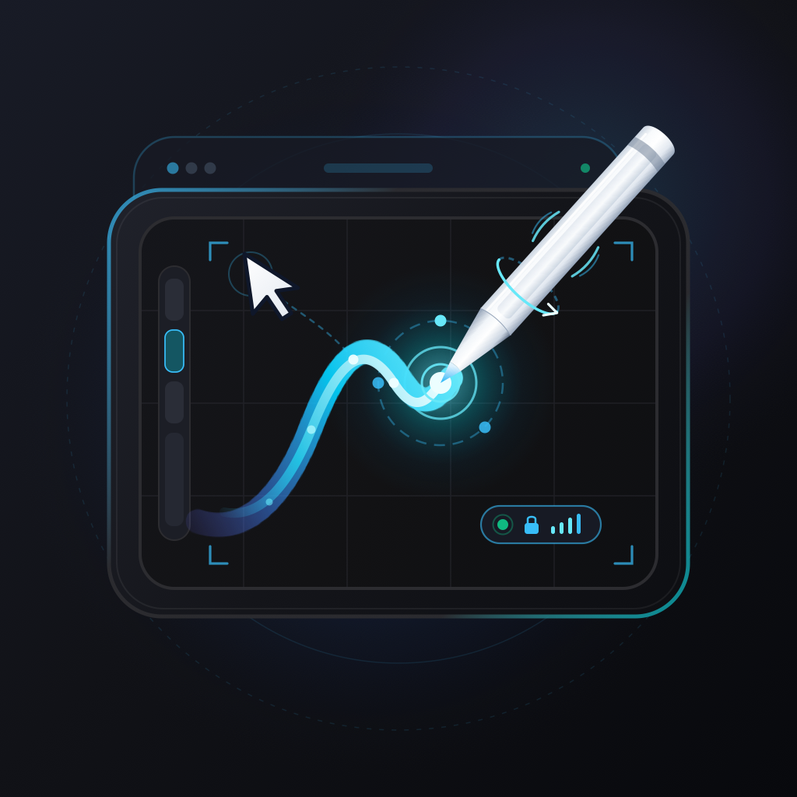
</p>

<h1 align="center">VirtualTabletPad</h1>

<p align="center">
  <strong>将 iPad 化身为 Mac 的高精度专业数位板与多点触控板</strong>
</p>

<p align="center">
  <a href="#核心特性">特性</a> •
  <a href="#界面预览">预览</a> •
  <a href="#快速上手">快速上手</a> •
  <a href="#连接方式">连接方式</a> •
  <a href="#架构设计">架构</a> •
  <a href="#系统要求">系统要求</a> •
  <a href="README.md">English</a>
</p>

<p align="center">
  
  
  
  
  
</p>

---

**VirtualTabletPad** 是一款专为创作者与生产力用户设计的开源工具。通过自研的高效低延迟协议，它能将你的 iPad 瞬间变为 Mac 的**高刷新率数位板**（支持 Apple Pencil Pro 全套硬件特性）以及**大面积多点触控板**。

支持 **USB-C 直连**（仅需 1.4~1.8 ms 传输往返 RTT，无需局域网或 Wi-Fi）与 **Wi-Fi Bonjour 自动组网**，同时内置端到端加密（E2EE），确保输入与文件传输安全私密。详见 [docs/latency.md](docs/latency.md)。

<p align="center">
  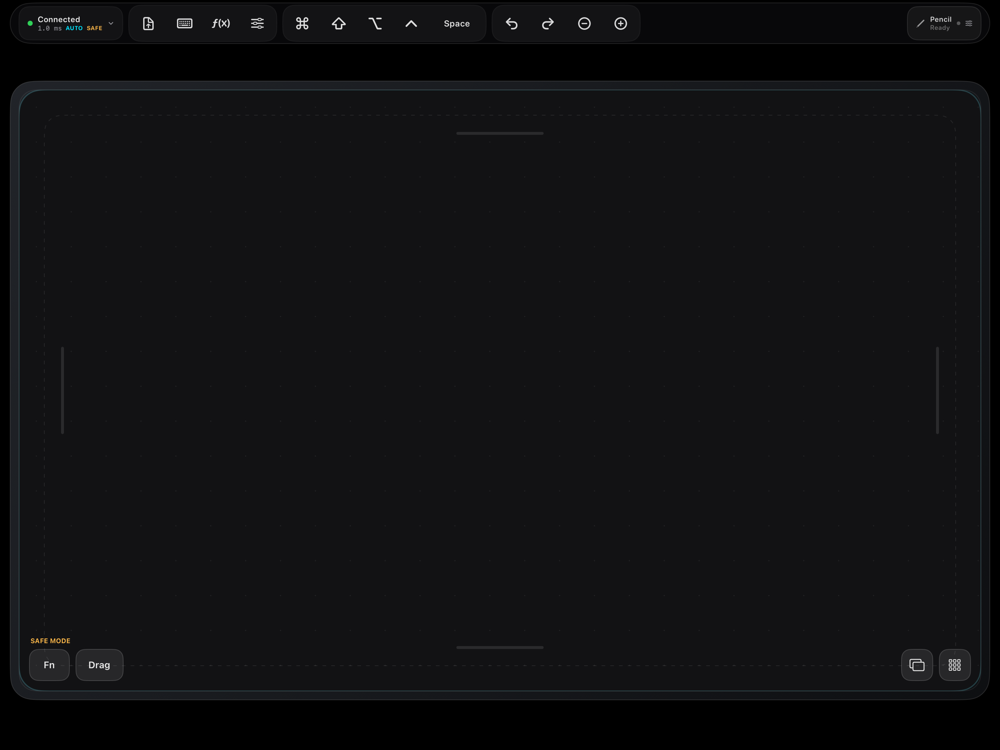
  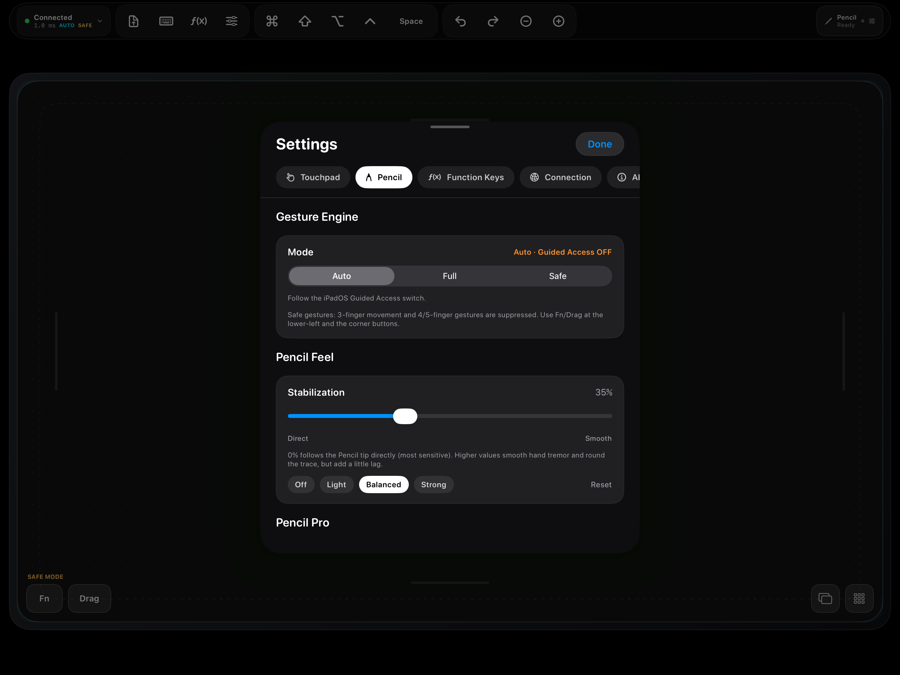
</p>

---

## 🌟 核心特性

### 1. 🎨 专业级 Apple Pencil / 数位板引擎
* **240 Hz 超高采样率**：基于原生 `UIEvent.coalescedTouches` 捕获，笔尖跟手无迟滞，自带毫秒级局部墨迹预测渲染（Transient Ink）。
* **Apple Pencil Pro 硬件扩展**：
  * **侧旋（Barrel Roll）**：完整同步握笔旋转角度（`rollAngle`）。
  * **轻捏（Squeeze）与双击（Double Tap）**：触发环形快捷工具盘（Radial Palette HUD）并伴随原生震动反馈（Haptics）。
  * **悬停与倾角（Hover & Tilt）**：支持高精度光标预览与笔触方位角/倾斜角传感。
* **硬件级抗抖动与压感曲线**：内置 0–100% 动态平滑滤波，消除手部微颤；支持自然（Natural）、轻柔（Soft）、紧致（Hard）三档硬件压感映射。
* **纯笔防误触（Palm Rejection）**：在绘图模式下智能屏蔽手掌误触，仅响应手写笔信号。

### 2. ⚡ 极速低延迟：USB-C 原生隧道 & 无缝无线
* **USB-C 有线直连（极力推荐）**：
  * 基于 `usbmuxd` 原生隧道通讯，**往返 RTT 低至 1.4 ~ 1.8 ms**（在 120 Hz ProMotion 屏幕上触控到光标总延迟仅约 **9 ~ 14 ms**；详见 [docs/latency.md](docs/latency.md)）！
  * 即插即用，无需配置网络适配器，不占用 Wi-Fi / 个人热点或系统代理。
* **Wi-Fi / AWDL 自动发现**：通过 Bonjour 协议自动广播与扫描，局域网内秒速配对。
* **一键扫码配对**：Mac 状态栏直接生成专属连接二维码，iPad 扫码即连。
* **自动重连与防冲突**：断线后智能自动重连；主机端排他性会话锁，防止多端冲突。

### 3. 🖐️ 拟真触控板与双模手势系统
* **原生 1~5 指多点触控**：支持单指轻点/移动、双指顺滑滚动（支持自然方向切换）、双指右键、三指拖移/查找、四/五指调度中心等。
* **双模手势引擎（完美兼顾系统与安全）**：
  * **引导式访问（Guided Access）模式**：启动 iPad 引导式访问后，iPadOS 系统手势被完全接管，iPad 成为一块纯黑的高灵敏原生触控板。
  * **安全模式（Safe Mode）**：未开启引导式访问时，提供安全防护区、边缘滚动轨与 Fn/Drag 锁定角，防止误触发 iPad 桌面切屏。
* **触控手感引擎**：支持指针加速度、低速精密模式、平滑停止防抖、自定义长按拖拽延迟等细致调校。

### 4. 🪟 Liquid Glass 拟物工作区 & Touch Bar 快捷条
* **16:10 黄金比例画幅**：画布比例严格映射 Mac 显示器，提供 12pt 触觉边框与防边缘误触设计。
* **Touch Bar 风格集成顶栏**：
  * **F1–F12 功能键区**：直接控制 Mac 屏幕亮度、调度中心、台前调度、桌面切换、媒体与音量。
  * **修饰键岛**：`Command`、`Option`、`Control`、`Shift`、`Space` 常驻点按与锁定。
  * **创作快捷区**：撤销/重做、笔刷大小微调、软键盘切换。
* **键盘模式自适应**：呼出软键盘时，工作区智能折叠为双行紧凑 F 键与修饰键面板，保持全键盘效率。

### 5. 🔒 严谨密码学与零分配传输协议
* **Ed25519 + X25519 + HKDF-SHA256 + AES-GCM-256**：双向身份签名验证、临时会话密钥协商、定向密钥导出与 128 位 AEAD 完整性认证，杜绝中间人攻击与篡改。
* **固化 28 字节紧凑报文（`VPadPacket`）**：240 Hz 热循环输入路径实现零堆内存分配（Zero Allocation），内置 64 包滑动窗口防重放过滤机制。

### 6. 📁 隔空秒传（Drop Transfer）
* 支持从 iPad 直接向 Mac 拖拽/发送大文件或文档，传输全程通过分片加密流传输，并在 Mac 端进行 SHA-256 哈希校验。

---

## ⚖️ 方案横向对比

VirtualTabletPad 专注于**纯数字化手写与触控输入协议**，不传输压缩视频流，因此免去了视频编解码带来的画质损失、高发热与屏幕延迟。

| 特性 / 解决方案 | VirtualTabletPad | Apple Sidecar | 通用控制 (Universal Control) | Astropad Studio | Duet Display |
|---|:---:|:---:|:---:|:---:|:---:|
| **核心定位** | 专业数位板与触控板 | 屏幕镜像与扩展 | 跨设备光标共享 | 专业数位板 | 第二便携显示屏 |
| **视频流开销** | **无**（直接看 Mac 屏幕绘图） | 较高（H.264/HEVC 串流） | 无 | 较高（专有视频流） | 较高（虚拟屏幕驱动） |
| **Apple Pencil Pro 硬件特性** | **全面支持**（侧旋/轻捏/触觉反馈） | 仅基础压感/倾角 | 不支持 Mac 绘图应用 | [TODO(human): 实机验证侧旋兼容度] | 仅基础压感 |
| **输入协议与采样率** | 240 Hz 聚合 UDP（E2EE 加密） | 系统内部 IPC | 系统内部 IPC | 专有 TCP/USB | 专有协议 |
| **往返传输 RTT（USB 直连）** | **~1.4 ms**（详见 [docs/latency.md](docs/latency.md)） | ~15–30 ms 画面往返 | ~5–12 ms | [TODO(human): 统一环境下基准测试] | ~20–40 ms |
| **自定义压感曲线与屏幕映射** | **支持**（三次贝塞尔 LUT 与多屏映射） | 不支持 | 不支持 | 支持 | 仅有限映射 |
| **多点触控板模式** | **支持**（1–5 指完整手势） | 不支持 | 不支持 | 不支持 | 仅有限模拟 |
| **开源协议与商业模式** | **完全开源 (GPL-3.0)** | 苹果闭源独占 | 苹果闭源独占 | 商业订阅制 | 商业订阅制 |

---

## 📚 技术架构与深度文档

深入了解 VirtualTabletPad 的底层协议设计、延迟测试基准与驱动架构：

- [通信协议规范 (v2)](docs/protocol.md)：包含完整握手流程、56 字节 UDP 报文外壳、28 字节 `VPadPacket` 布局、Windows `InjectSyntheticPointerInput` 与 Linux `uinput` 适配指南及测试向量。
- [延迟测量基准与流水线解析](docs/latency.md)：往返 RTT 与“笔尖到光标”玻璃到玻璃延迟流水线剖析，附带 `Tools/latency-bench` 自测工具。
- [安全性架构与威胁模型](docs/security.md)：双向认证、防重放滑动窗口、文件沙箱隔离与解析器模糊测试报告。
- [专业创作软件兼容性矩阵](docs/compatibility.md)：覆盖 Photoshop、Clip Studio Paint、Krita、Blender、Illustrator、Affinity 等软件的压感/倾角/侧旋支持实测。
- [DriverKit 虚拟 HID 驱动可行性分析](docs/driverkit_feasibility.md)：`IOUserHIDEventDriver` 与 `CGEvent` 合成事件注入的架构优劣势评估。

---

## 🔧 常见问题与排错指南

#### 1. Mac 端对 Pencil 笔触或触控无响应
- 请确认已在 **系统设置 → 隐私与安全性 → 辅助功能** 中授予 `VirtualTabletPad` 权限。
- 若需彻底重置辅助功能权限缓存，请在终端执行：
  ```bash
  tccutil reset Accessibility com.vpad.MacHost
  ```
- 重新勾选授权后重启 MacHost。

#### 2. USB-C 直连显示“未连接”
- 请确保使用的是支持数据传输的高速线缆（非仅能充电的普通充电线）。
- 连接 iPad 时如果弹出“信任此电脑”，请点击“信任”。
- VirtualTabletPad 会自动识别 `169.254.x.x` 本地链路地址或建立 `usbmuxd` 隧道。

#### 3. Wi-Fi 模式下无法扫描到 Mac 主机
- 确保 Mac 与 iPad 处于同一 Wi-Fi 子网或局域网。
- 确认 Mac 防火墙没有拦截 UDP `8888` 端口与 TCP `8889` 端口的入站连接。
- 在部分隔离组网的企业 Wi-Fi 下，建议优先使用 **USB-C 有线直连** 或 **扫码直连**。

#### 4. 笔迹抖动或手掌误触
- 可在 Pencil 设置中开启 **“纯手写笔模式 (Palm Rejection)”**，此时触摸屏将彻底忽略手部电容信号。
- 调节 **“抗抖动 (Stabilization)”** 滑块，滤除手部细微生理震颤。

---

## 📸 界面预览

以下截图均来自最新的 **iPadOS 27 模拟器（iPad Pro 13-inch M5）**；上方主图为模拟器中的 Liquid Glass 工作台与 Pencil 设置中心。

<table style="width:100%; text-align:center;">
  <tr>
    <td width="50%">
      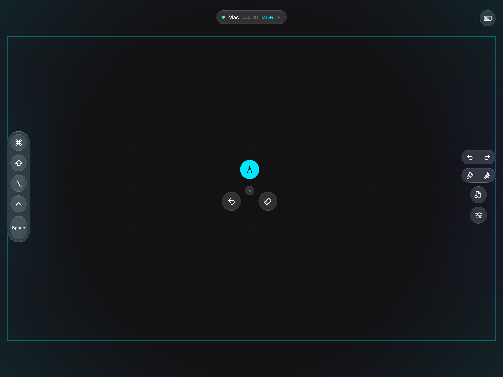
      <br /><b>Pencil Pro 轻捏呼出环形工具盘</b>
    </td>
    <td width="50%">
      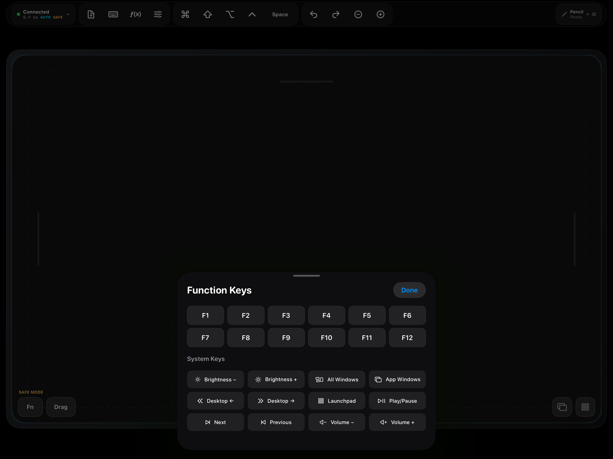
      <br /><b>F1-F12 与 Mac 系统级控制中心</b>
    </td>
  </tr>
  <tr>
    <td width="50%">
      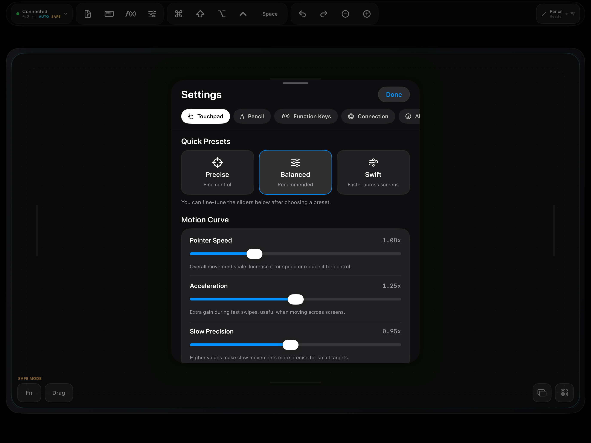
      <br /><b>Touchpad 设置 · 快速预设与运动曲线</b>
    </td>
    <td width="50%">
      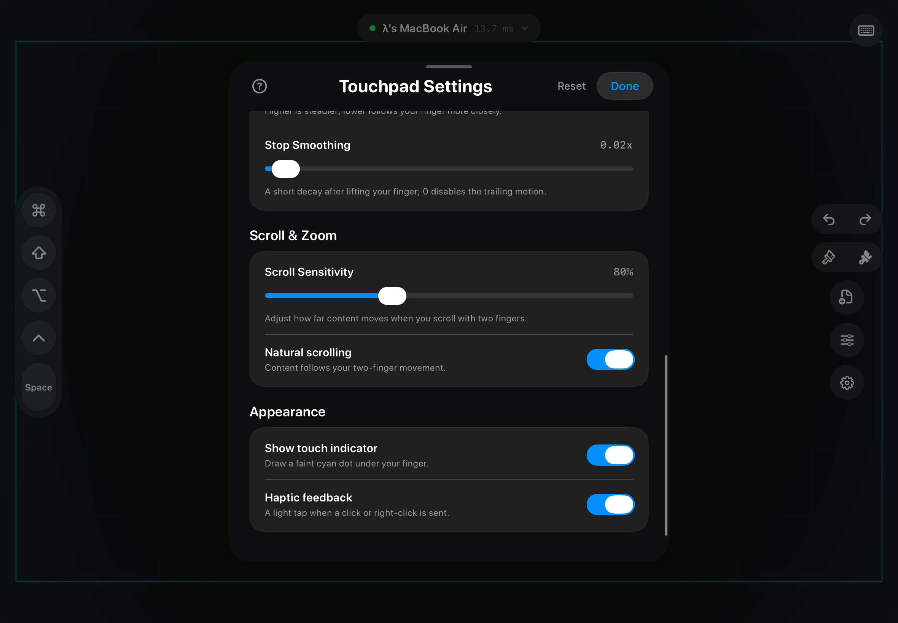
      <br /><b>Touchpad 设置 · 手感、滚动与外观</b>
    </td>
  </tr>
  <tr>
    <td width="50%">
      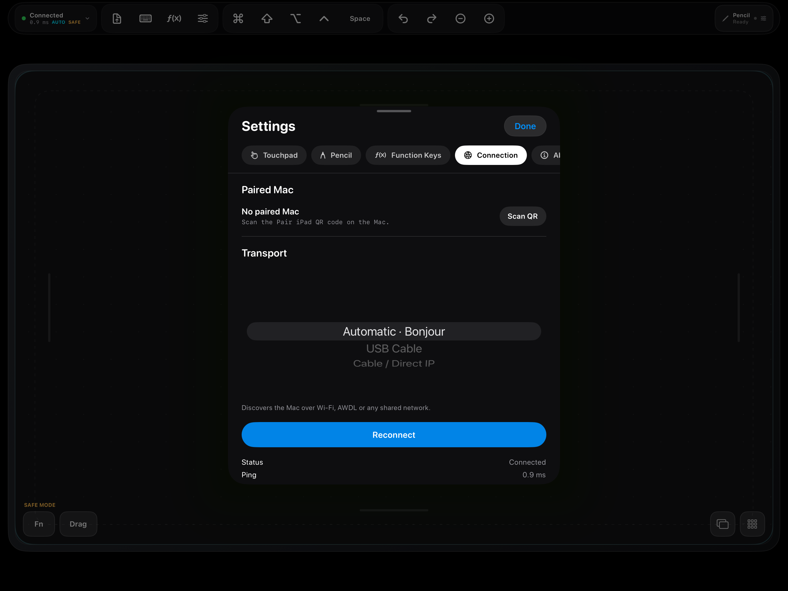
      <br /><b>连接设置 · Bonjour / USB / Direct-IP</b>
    </td>
    <td width="50%">
      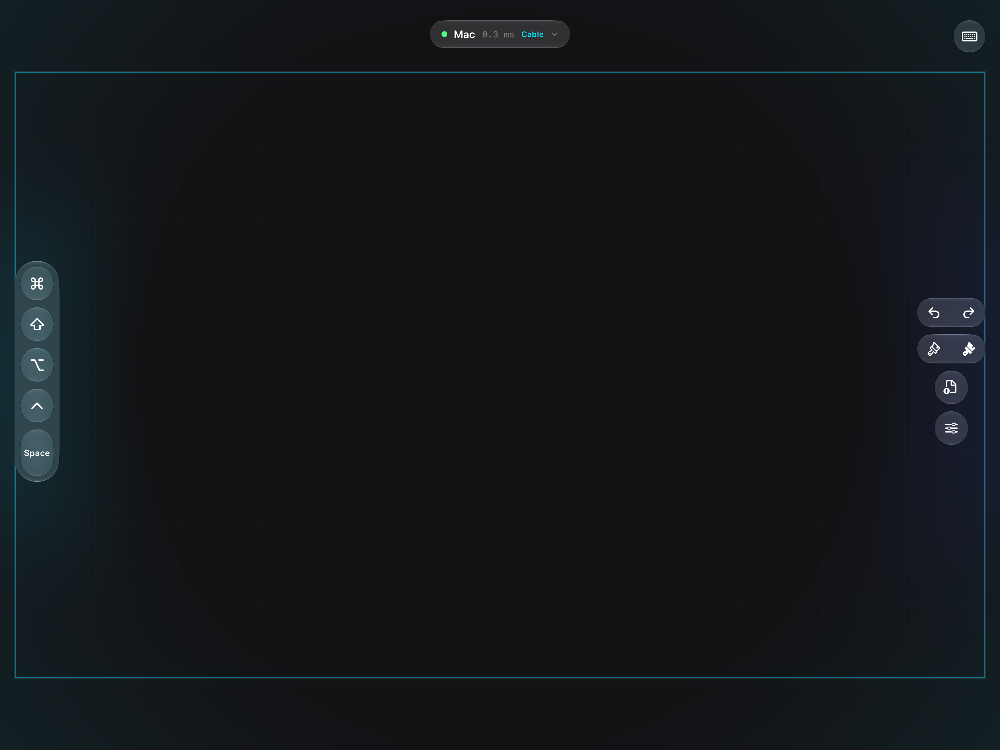
      <br /><b>Direct-IP 直连（USB-C / 以太网）</b>
    </td>
  </tr>
  <tr>
    <td width="50%">
      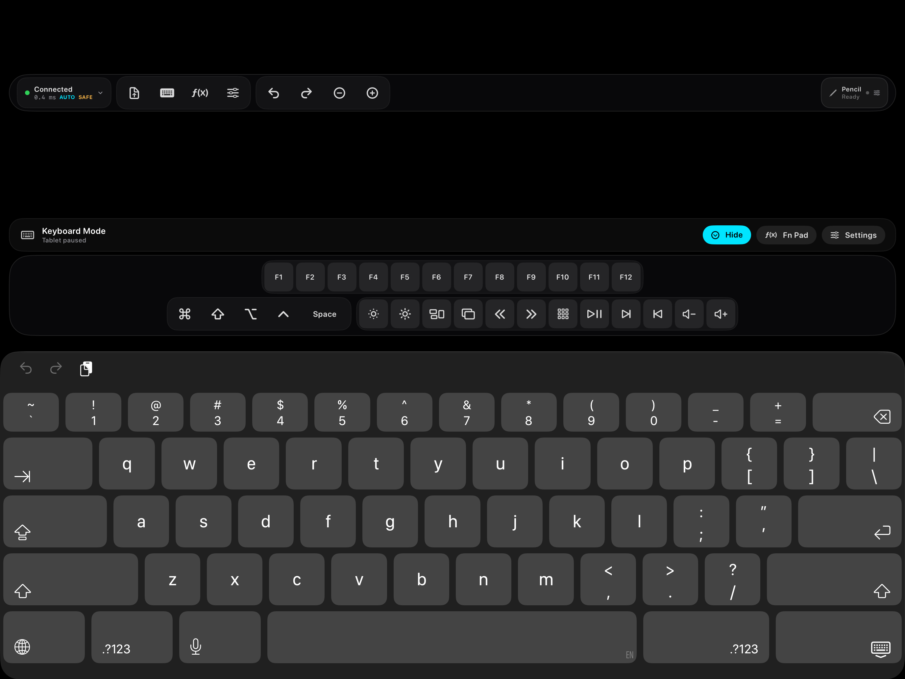
      <br /><b>软键盘呼出时的自适应双行 F 键扩展</b>
    </td>
    <td width="50%">
      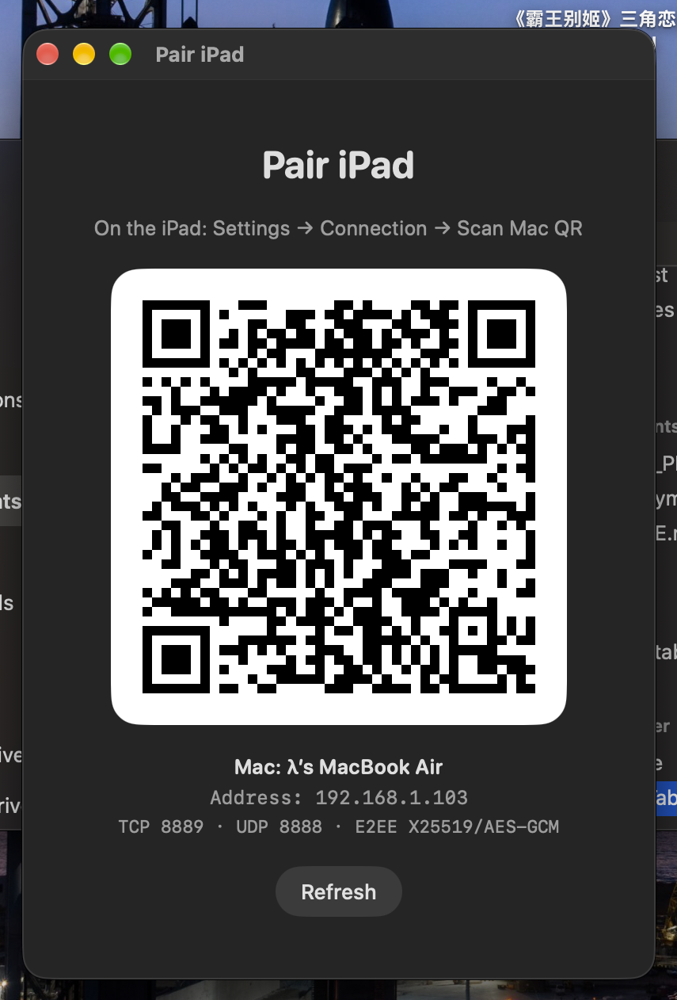
      <br /><b>Mac 状态栏一键扫码无线配对</b>
    </td>
  </tr>
</table>

---

## 🛠️ 系统与硬件要求

| 设备 | 最低要求 | 推荐配置 |
|:---|:---|:---|
| **Mac (主机端)** | macOS 14.0 (Sonoma) 及以上 | macOS 15+ / Apple Silicon (M 系列芯片) |
| **iPad (客户端)** | iPadOS 17.5 及以上 | iPad Pro / iPad Air (支持 Apple Pencil Pro / 240Hz ProMotion) |
| **手写笔** | Apple Pencil (一代/二代/USB-C) | Apple Pencil Pro (支持悬停、压感、轻捏、侧旋与触感) |
| **连接介质** | Wi-Fi / AWDL 局域网 | 原装 USB-C 数据线（可达到 1.4ms 极致延迟） |

---

## 🚀 快速上手

### 1. 源码编译与安装

本项目使用 [XcodeGen](https://github.com/yonaskolb/XcodeGen) 统一管理工程结构，代码采用 Swift 6 编写。

```bash
# 1. 克隆代码仓库
git clone https://github.com/Lambda-404/VirtualTabletPad.git
cd VirtualTabletPad

# 2. 运行协议包单元测试 (25 项全通)
make test

# 3. 生成 Xcode 工程并编译 MacHost
make build

# 4. 运行 Mac 主机端 (状态栏常驻)
make run-dev
```

> **首次运行权限提示**：
> - **辅助功能权限（Accessibility）**：用于向 macOS 注入光标移动、鼠标点击与键盘事件。
> - **本地网络权限（Local Network）**：用于 Bonjour 服务发现与握手通信。

### 2. 部署到 iPad

#### 方式 A：通过 Xcode 安装（推荐）
1. 双击打开 `VirtualTabletPad.xcodeproj`。
2. 在 Target 中选择 `iPadClient`。
3. 在 `Signing & Capabilities` 中选定你的 Apple 开发者账号（个人免费签名亦可）。
4. 连接 iPad，在顶部设备栏选择该 iPad，点击 **Run** 即可部署。

#### 方式 B：通过命令行部署
```bash
UDID=<你的-iPad-UDID>
TEAM=<你的-Apple-Team-ID>

# 编译并签名
xcodebuild -project VirtualTabletPad.xcodeproj -scheme iPadClient -configuration Debug \
  -destination "platform=iOS,id=$UDID" -derivedDataPath /tmp/VPadBuild \
  -allowProvisioningUpdates DEVELOPMENT_TEAM="$TEAM" CODE_SIGN_STYLE=Automatic build

# 安装并启动
xcrun devicectl device install app --device "$UDID" /tmp/VPadBuild/Build/Products/Debug-iphoneos/VirtualTabletPad.app
xcrun devicectl device process launch --device "$UDID" com.vpad.iPadClient
```

> **提示**：首次在真机运行自行签名的应用，需在 iPad 打开 **设置 → 通用 → VPN 与设备管理 → 开发者 App → 点击信任**，并在 **设置 → 隐私与安全性** 中启用“开发者模式”。

---

## 🔌 两种连接模式

### 1. USB-C 极速有线模式（首选，低至 1.4ms）
1. 用 USB-C 数据线连接 Mac 与 iPad。
2. 打开 iPad 上的 VirtualTabletPad，进入 **设置 → 连接**，选择 **USB Cable** 模式。
3. 系统将通过 usbmuxd / 链路本地地址（Link-Local 169.254.x.x）建立点对点直连，顶部连接胶囊会显示 `Cable`，延迟通常稳定在 **1.4 ~ 1.8 ms**。

### 2. Wi-Fi / AWDL 无线模式
1. 确保 Mac 与 iPad 处于同一 Wi-Fi 网络（或开启蓝牙利用 AWDL）。
2. Mac 端点击状态栏图标，选择 **Pair iPad…** 弹出二维码窗口。
3. iPad 端点击连接卡片中的 **Scan QR**，对准屏幕扫码即可瞬间配对。

---

## 💡 使用进阶技巧：配合“引导式访问”获得最佳触控体验

由于 iPadOS 自带由屏幕底部上滑返回主屏幕、边缘滑动切换 App 等全局系统手势，在作为触控板使用时可能产生冲突。

**推荐开启“引导式访问”（Guided Access）**：
1. 打开 iPad **设置 → 辅助功能 → 引导式访问**，将其开启，并打开快捷键（连按三次侧边键/主屏幕键）。
2. 打开 VirtualTabletPad 后，**连按三次电源键启动引导式访问**。
3. 应用将自动感知并切换到 **Full Native 全手势模式**：
   - 界面所有安全边框和热区提示自动隐藏，呈现纯净触控板表面。
   - 1~5 指全部原生手势均可毫无顾忌地肆意挥洒，完全不会误退应用！

---

## 🏗️ 架构与技术栈

```text
VirtualTabletPad/
├── Packages/VPadProtocol/        # 核心通信协议库 (SPM)
│   ├── VPadPacket.swift          # 28 字节紧凑报文定义 (Zero-Heap-Allocation)
│   ├── CryptoManager.swift       # X25519 + HKDF + AES-GCM-256 加解密引擎
│   └── VPadConstants.swift       # 事件码、位掩码与端口规范
├── MacHost/                      # macOS 状态栏服务端
│   ├── UDPServer.swift           # UDP 8888 极速数据接收解密循环 (QoS: userInteractive)
│   ├── TCPServer.swift           # TCP 8889 会话握手、心跳控制与文件流接收
│   ├── USBProxy.swift            # 基于 usbmuxd 的 USB 有线隧道桥接
│   ├── EventInjector.swift       # CGEvent 虚拟触控、数位笔与按键注入引擎
│   └── AccessibilityManager.swift# 辅助功能无感知轮询授权管理
└── iPadClient/                   # iPadOS 客户端
    ├── LiquidGlassWorkspace.swift# Liquid Glass 拟物化 16:10 数位板与 Touch Bar 视图
    ├── CanvasView.swift          # 240Hz 笔触与手势捕获引擎
    ├── UDPClient.swift           # 高吞吐保序 UDP 发送管道
    └── TouchpadSettingsView.swift# 触控手感、加速度曲线与笔触参数配置中心
```

---

## 📄 开源许可证

本项目基于 [GNU General Public License v3.0 (GPL-3.0)](LICENSE) 开源。

你可以自由使用、修改及学习本项目源码，任何基于本项目的衍生作品或包含本项目代码的再分发版本均须以 GPL-3.0 协议开源。欢迎提交 Issue 与 Pull Request 共同完善！
